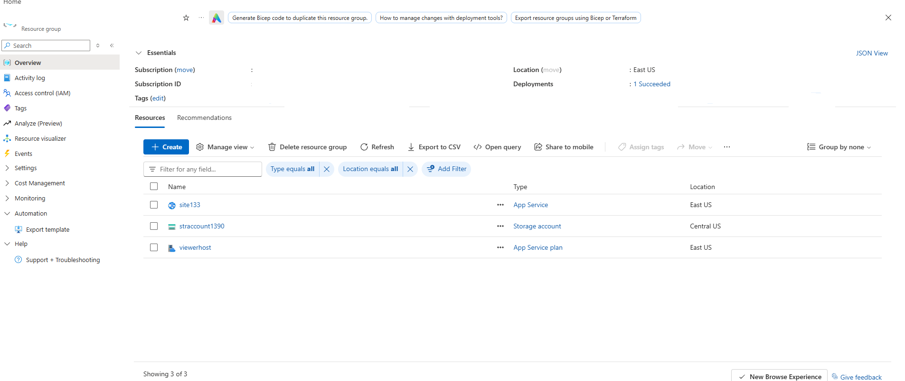
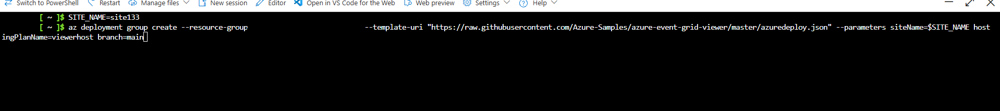
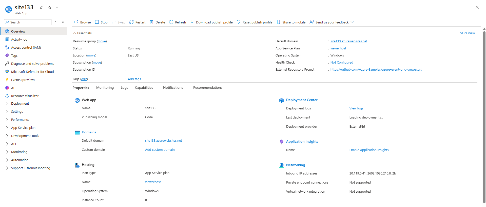
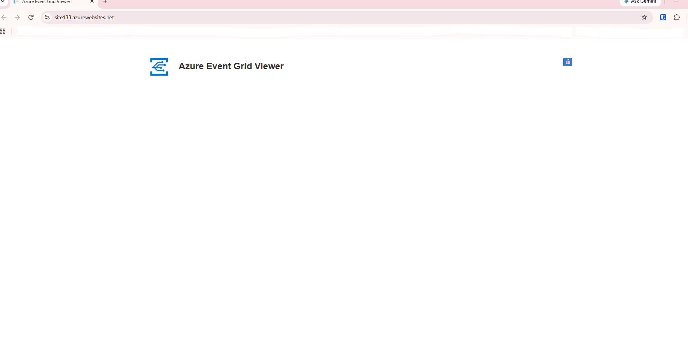
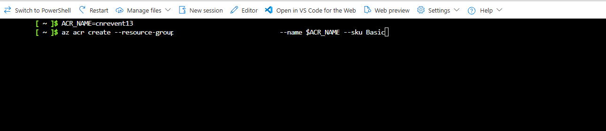
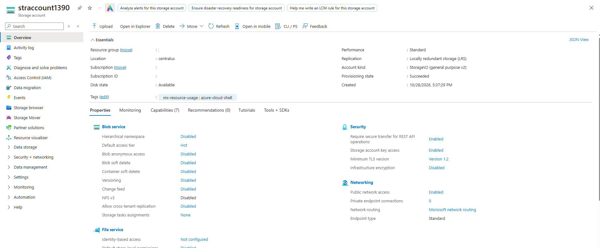
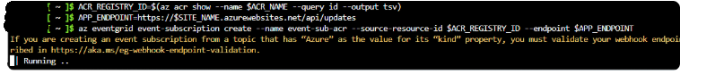
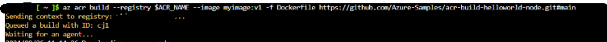
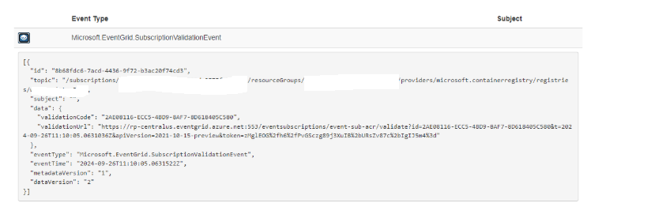
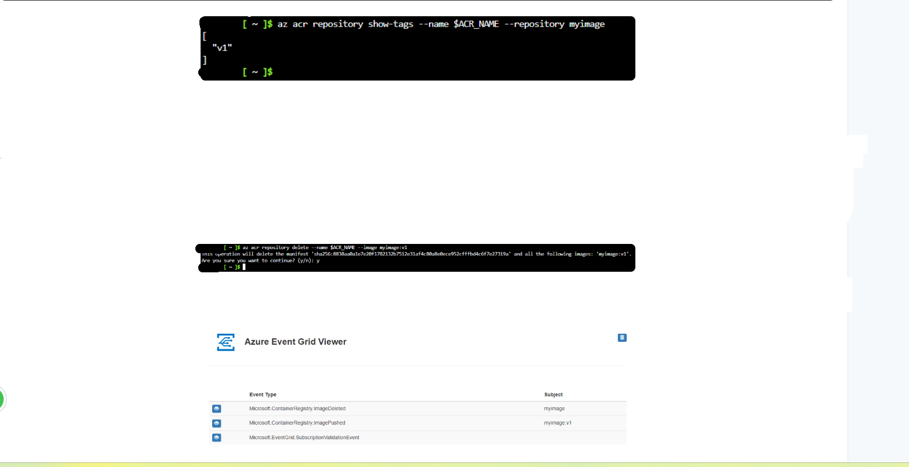

# Send Events from Private Container Registry to Event Grid

---

## 1. Architecture & Provisioned Resources

### Core Infrastructure Topology

| Resource Type | Resource Name | Specification / Purpose | Region / Location |
| :--- | :--- | :--- | :--- |
| **Azure Container Registry** | `cnrevent13` | Private container registry (`Basic` SKU) emitting lifecycle events | East US |
| **App Service** | `site133` | Web application hosting the Azure Event Grid Viewer | East US |
| **App Service Plan** | `viewerhost` | Free (F1) App Service plan hosting the viewer site | East US |
| **Storage Account** | `straccount1390` | General Purpose V2 storage (`Standard_LRS`) supporting cloud shell | Central US |
| **Event Subscription** | `event-sub-acr` | WebHook event subscription routing ACR events to `/api/updates` | Global |

---

### Provisioned Environment Validation

*Resource group inventory confirming successful deployment of App Service, Storage Account, and App Service Plan.*

---

## 2. Step-by-Step Implementation

### Step 1: Deploy Web Endpoint (Event Grid Viewer)

1. Deployed the Azure Event Grid Viewer web application using `az deployment group create` with an ARM deployment template.
2. Verified successful creation of App Service `site133` hosted on App Service plan `viewerhost`.

*Azure CLI command executing deployment group create to provision the Event Grid Viewer site.*

---

*Azure Portal overview for site133 Web App confirming running status and default domain.*

---

*Azure Event Grid Viewer web site interface loaded and ready to receive events.*

---

### Step 2: Provision Azure Container Registry

1. Executed `az acr create` to provision a private Azure Container Registry named `cnrevent13` with the `Basic` SKU.
2. Verified registry creation to serve as the event source for Event Grid.

*Azure CLI command executing az acr create to provision private container registry cnrevent13.*

---

*Azure Portal overview for supporting storage account straccount1390.*

---

### Step 3: Create Event Grid Subscription

1. Retrieved the resource ID of `cnrevent13` and set the WebHook endpoint URL targeting `/api/updates`.
2. Created the Event Grid event subscription named `event-sub-acr` using `az eventgrid event-subscription create`.

*Azure CLI command creating event subscription event-sub-acr linking container registry events to WebHook endpoint.*

---

### Step 4: Trigger Container Registry Events

1. Built and pushed a container image (`myimage:v1`) to `cnrevent13` using `az acr build` to emit an `ImagePushed` event.
2. Deleted the container image tag (`myimage:v1`) using `az acr repository delete` to trigger an `ImageDeleted` event.

*Azure CLI command az acr build pushing image myimage:v1 to the container registry.*

---

## 3. Verification & Monitoring

### Step 1: Verify Subscription Validation Event

1. Checked the Event Grid Viewer application interface following subscription registration.
2. Confirmed receipt of `Microsoft.EventGrid.SubscriptionValidationEvent` for the Container Registry topic.

*Azure Event Grid Viewer displaying the subscription validation event payload.*

---

### Step 2: Verify Image Push and Delete Event Payload

1. Verified repository tag status and executed image deletion via Azure CLI.
2. Confirmed real-time capture of `Microsoft.ContainerRegistry.ImagePushed` and `Microsoft.ContainerRegistry.ImageDeleted` event payloads in the Event Grid Viewer.

*Azure Event Grid Viewer displaying real-time ImagePushed and ImageDeleted event payloads.*
